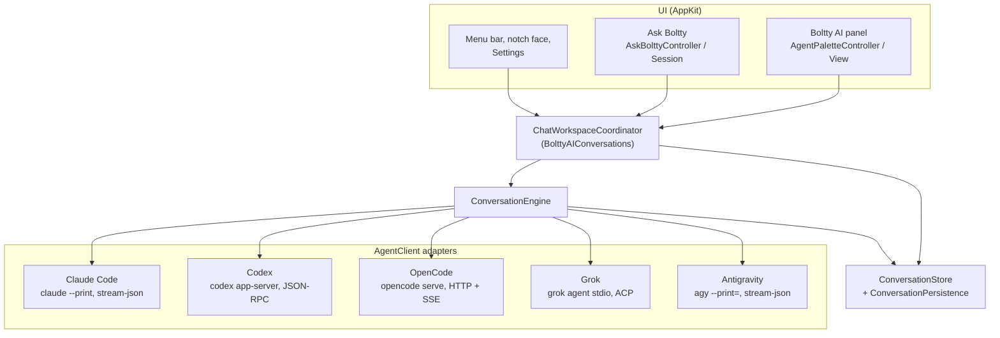

# How Boltty works

This is the map. It covers the main pieces, how a prompt travels from ⌥Space
to an agent and back, and the few rules that keep it in one piece.
[AGENTS.md](AGENTS.md) has the full detail, especially about the individual
CLIs.

## The one idea

Boltty is a client for agent CLIs that are already on your Mac. It doesn't
run a model, and it doesn't give an agent anything the agent couldn't already
reach from your terminal. What it adds is a place to start work from anywhere,
a way to see and answer what an agent is asking, and memory of the
conversation.

So almost everything hangs off one seam: **`AgentClient`**. Above it is a
generic chat app. Below it are five adapters, one per CLI, each speaking
whatever that CLI actually speaks.

## The pieces

**`AppDelegate`** builds everything at launch and owns it: the store, the
engine, the coordinator, the panel, the menu bar item. The order matters:
the global hotkey and the menu bar come up first, and the conversations are
loaded from disk after, so ⌥Space works from the first moment.

**The panel** (`UI/AgentPalette*`) is Boltty AI: one glass shell that is the
prompt, the list of recent chats and the open chat, morphing between them on
a single spring. It only ever talks to `BolttyAIConversations`, a protocol the
coordinator implements. It never starts a process, and hiding it never stops
one.

**`ChatWorkspaceCoordinator`** is the app's side of a conversation: starting
one, sending a follow-up, queuing a message while a turn runs, answering a
permission, notifications, the tray's list. It turns UI intents into engine
calls.

**`ConversationEngine`** is the only thing that calls an adapter. It creates
sessions, sends messages, streams events into the store, stops turns, and
recovers when a CLI has forgotten a session (it drops the dead id and opens a
new one, once). It also bounds every call with a deadline, so one slow CLI
can't stall the others.

**`ConversationStore`** holds every conversation in memory and publishes
changes; **`ConversationPersistence`** writes them to
`~/Library/Application Support/Boltty/Conversations`. Only one running Boltty
may write. A second copy takes an advisory lock, finds it held, and runs
read-only (the menu bar says so).

**Adapters** (`Chat/ClaudeCode`, `Chat/Codex`, `Chat/OpenCode`, `Chat/Grok`,
`Chat/Antigravity`) each implement `AgentClient`: probe whether the CLI is
installed, list its models, create and resume sessions, send, stop, answer
permissions and questions, and stream events. `AgentRegistry` lists them.

## Following one prompt

1. You press ⌥Space. Carbon's hotkey (no permission needed) shows the panel.
2. You type and press Return. The panel asks the coordinator to start a
   conversation with the chosen agent and folder.
3. The coordinator creates a `Conversation` in the store and hands the prompt
   to the engine.
4. The engine asks the adapter for a session id, creates the session (for
   Claude Code that means starting a `claude --print` process, for OpenCode an
   HTTP call to its server) and sends the message.
5. The adapter turns whatever the CLI prints (stream-json lines, JSON-RPC
   notifications, server-sent events) into `AgentEvent`s: text arriving, a
   tool call starting, a permission requested, the turn ending.
6. The engine applies those events to the store. The panel, the tray and the
   notch face observe the store and redraw.
7. If the agent asks for permission, a card appears in the chat. Your answer
   goes back down the same path to the CLI's own permission mechanism.
8. When the turn ends you get a sound and, if Boltty isn't in front, a banner.

After a relaunch nothing is re-run. When you open an old chat, the adapter
reads its history from the CLI's own record (Claude Code's `.jsonl`, Codex's
rollout file, OpenCode's database and so on), never by asking a process to
replay it.

## Ask Boltty

Holding ⌃⌥⌘ is watched by a listen-only event tap (the one place one is
allowed, and the reason this feature needs Input Monitoring). While the chord
is held, Boltty freezes a picture of the screen, records the pointer's path,
listens through Apple's on-device speech recognizer, and warms up the agent's
session. On release it sends the picture, the traced line and the words as a
normal conversation, marked as an Ask Boltty chat. The answer is shown beside
the pointer as it streams; small tags in it (`<point>`, `<circle>`, `<arrow>`,
…) make the face fly to a spot or draw on the screen. These chats are
read-only by default and are forgotten ten minutes after the last answer.

## Rules that hold it together

- **Capabilities are declared, not guessed.** Each adapter says what it can do
  in `AgentCapabilities`, and the UI reads only that. No control appears for
  something the CLI behind it can't carry out.
- **Nothing in the UI touches a process.** Processes live in the adapters
  (through `JSONLineProcess` and `OneShotCommand`). The architecture linter
  enforces it.
- **A child process can die at any moment.** Boltty ignores `SIGPIPE`, writes
  to a child one line at a time, puts a timer on every deadline, and reads a
  CLI's last stderr line before reporting that it exited.
- **Permissions stay the CLI's.** Boltty asks the way each CLI asks and
  answers through its own mechanism. It never turns on a CLI's "skip all
  permissions" mode, with one exception: Antigravity's print mode can't ask at
  all, so Boltty runs it with that flag *and* installs a hook that sends every
  tool call to Boltty for a decision first.
- **The environment is inherited.** An agent started from Boltty gets your
  environment, as it would in a terminal. The one thing Boltty keeps to
  itself is what it generates, like the password of its own OpenCode server.

## Things that aren't here on purpose

- **A terminal.** Boltty used to embed one, and it was taken out. There's no
  PTY, VT parser or shell integration, and there won't be again.
- **A model.** Boltty has no API keys and calls no LLM API itself.
- **Sync or a server.** Everything is local. The only network request Boltty
  makes on its own is the daily check for a new release on GitHub.
- **Third-party packages.** The app depends on nothing but Apple's frameworks.

## Where to look

| To change… | Start in |
|---|---|
| How the panel looks or moves | `UI/AgentPaletteView.swift`, `UI/AgentPaletteMetrics.swift` |
| What happens on Return | `UI/AgentPaletteController.swift`, `Chat/ChatWorkspaceCoordinator.swift` |
| Sending, streaming, recovery | `Chat/Store/ConversationEngine.swift` |
| One agent's behaviour | `Chat/<Agent>/` |
| Reading a CLI's history | `Chat/Native/` |
| Settings | `UI/Settings/` |
| Ask Boltty | `AskBolttyController.swift`, `Chat/AskBoltty/`, `UI/AskBolttyOverlayController.swift` |
| The mascot | `Chat/UI/ConversationAvatar.swift`, `MascotRenderer.swift`, `MascotShaders.metal` |
| Releases and updates | `scripts/release.sh`, `Services/AppUpdater.swift` |
