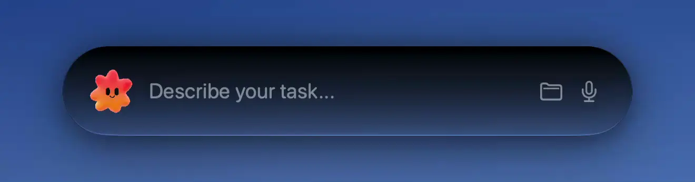
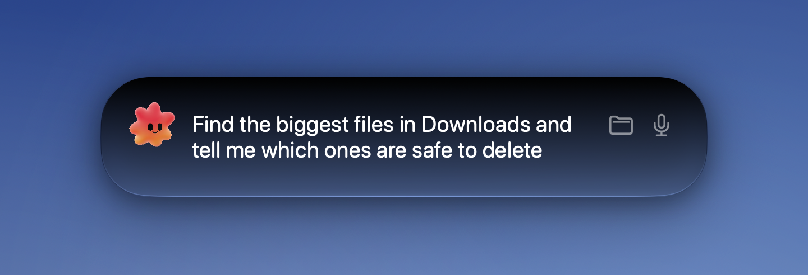
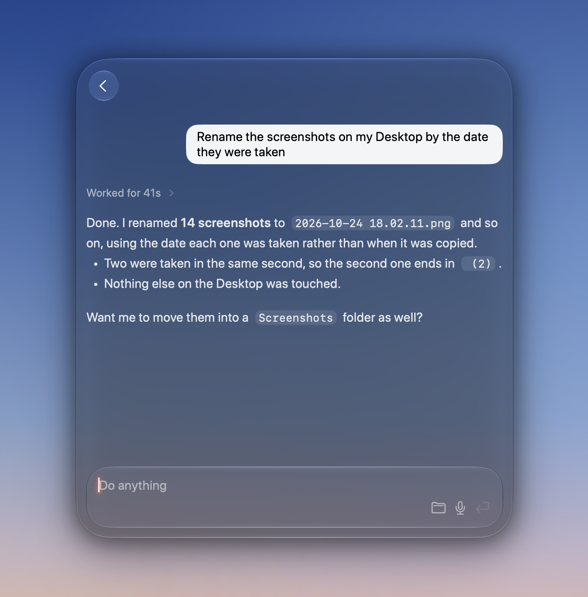
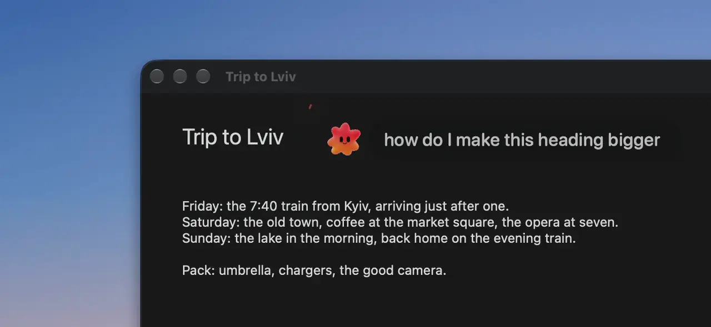
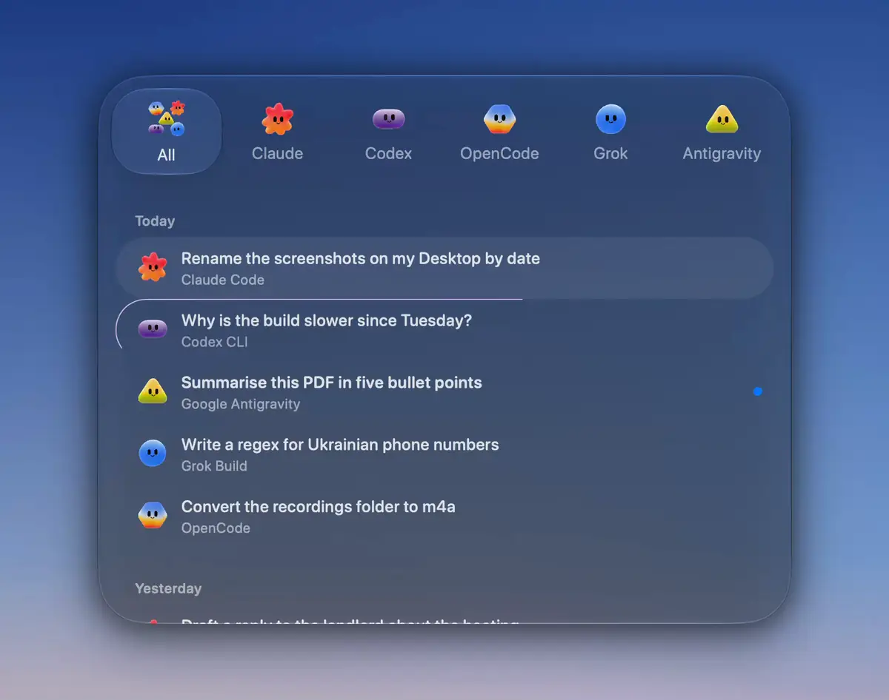

<p align="center">
  
</p>

<h1 align="center">Boltty</h1>

<p align="center">
  Press ⌥Space anywhere on your Mac and hand a task to the coding agent you already use.
</p>

<p align="center">
  <a href="https://github.com/ruslan-enko/boltty/releases/latest"></a>
  
  <a href="LICENSE"></a>
</p>

---

Boltty is a small native macOS app that sits in the menu bar and puts **Claude
Code, Codex, OpenCode, Grok and Antigravity** one shortcut away. You type (or
say) what you want, press Return, and the agent works in the background while
you carry on. When it's done, or when it needs a yes from you, Boltty tells
you.

It doesn't bring its own model and it isn't a terminal. It drives the CLIs you
have installed, the way you'd drive them yourself, and asks before an agent
runs a command or edits a file.

<p align="center">
  
</p>

## Why I built this

Most of my day is doing and running things, and along the way I keep asking an
AI for help. Siri is too weak for that. In the terminal, the same jobs are easy:
the agent CLIs handle them without a fuss. But I'm not always in a terminal.

So I made a Siri replacement on top of the CLIs I already use, one key away
from whatever I'm doing, for the simple tasks and the not-so-simple ones.

## What it does

**Boltty AI.** A floating prompt on ⌥Space. Return starts a chat in the
background, without stealing focus; the same panel turns into the chat when
you want to read the answer, follow up or approve something. ↓ shows your
recent chats, ⇧Tab picks which agent a new prompt goes to. Drag across the
screen first and the agent gets that part of it as a picture, plus the text
read off it.

<p align="center">
  
</p>

<p align="center">
  
</p>

**Ask Boltty.** Hold ⌃⌥⌘, ask about what's on your screen out loud, and
circle the thing you mean with the pointer. The agent's face answers right
next to the cursor, and can point at things or draw on the screen while it
explains.

<p align="center">
  
</p>

**Your agents, as they are.** Each one is driven over the interface that CLI
really offers, and Boltty only shows a control (model picker, stop button,
attach) where that agent can actually do it.

| Agent | How Boltty talks to it |
|---|---|
| Claude Code | `claude --print`, stream-json in and out |
| Codex | `codex app-server`, JSON-RPC |
| OpenCode | `opencode serve`, HTTP + server-sent events |
| Grok | `grok agent stdio`, Agent Client Protocol |
| Antigravity | `agy --print`, stream-json, with Boltty's own permission gate |

A few other things it does: chats survive a restart, a face by the notch shows
what's running, dictation works on-device in two languages, and Settings shows
how much each agent has been used against its plan limits.

Every agent gets a face of its own, and ↓ keeps your chats, a tab per agent:

<p align="center">
  
</p>

## Install

1. Download **[Boltty.dmg](https://github.com/ruslan-enko/boltty/releases/latest/download/Boltty.dmg)** from the [latest release](https://github.com/ruslan-enko/boltty/releases/latest).
2. Open it and drag Boltty into Applications.
3. Open Boltty and press **⌥Space**.

The release isn't notarized yet, so the first time macOS will refuse to open
it. Go to **System Settings › Privacy & Security**, scroll down and press
**Open Anyway**. You only do this once.

You need **macOS 26 or later** and at least one of the agents above installed
and signed in. Boltty doesn't install them for you; **Settings › Agents** shows
what it found. If you have none yet, `npm install -g opencode-ai` is the
quickest start.

### Updates

Once a day Boltty asks GitHub whether a newer release is out and, if so, says
so in the menu bar and in Settings. It never downloads or installs anything by
itself. To update, download the new DMG, quit Boltty from the menu bar and
drag the new one over the old.

## Keys

| | |
|---|---|
| Open or hide Boltty AI | `⌥Space` (change it in Settings › General) |
| Ask about the screen | hold `⌃⌥⌘` (turn on in Settings › Ask Boltty) |
| Pick the agent for a new prompt | `⇧Tab` |
| Recent chats | `↓`, then type to search |
| Stop a running turn | `⌘.` |
| Add to a running turn / queue it | `⌘Return` / `Return` |
| Back, then close | `Escape` |
| Settings | `⌘,` |

`⌘Q` puts Boltty away but keeps every agent running. To really quit, use
**Quit Boltty** in the menu bar icon. Settings › Shortcuts lists everything.

## Privacy and permissions

Boltty collects nothing and has no server. Your prompts go to the agent you
picked, which talks to its own service exactly as it does from your terminal.
Chats are stored on your Mac, in a folder you can open from Settings › General.
The only request Boltty makes on its own is the daily update check to GitHub,
and you can turn that off.

macOS will ask for a few permissions, each only when something needs it:

- **Microphone and Speech Recognition** for dictation (Apple's engine, on-device)
- **Screen Recording** to ask about part of the screen
- **Input Monitoring** for Ask Boltty's held ⌃⌥⌘ chord
- **Automation (Finder)** to pick up files you've selected in Finder

The ⌥Space hotkey itself needs no permission.

An agent started from Boltty can do whatever the same CLI can do from your
terminal. Boltty doesn't sandbox it; what it adds is the approval step and the
working folder you choose.

## FAQ

**Is this a terminal?** No. There's no terminal emulator in Boltty and there
won't be. It talks to the agents over their own protocols.

**Which agent should I use?** Whichever you already pay for. Boltty treats them
the same, and you can switch per chat with ⇧Tab.

**Can I see a chat I started from the terminal?** No, Boltty's history is the
chats started in Boltty. Each CLI keeps its own history for the rest.

**Why does ⌘Q not quit?** Because quitting would stop agents in the middle of
their work. ⌘Q hides Boltty; Quit Boltty in the menu bar really quits.

## Building from source

See [CONTRIBUTING.md](CONTRIBUTING.md). The short version:

```bash
git clone https://github.com/ruslan-enko/boltty.git
cd boltty/apps/macos
open Boltty.xcodeproj   # then ⌘R
```

How the pieces fit together is in [ARCHITECTURE.md](ARCHITECTURE.md), and
what changed between releases in [CHANGELOG.md](CHANGELOG.md).

## License

GPL-3.0-or-later, see [LICENSE](LICENSE). Use it, change it, share it; if you
ship a changed version, its source has to be open under the same licence.
Found a security problem? Please read [SECURITY.md](SECURITY.md) first.
