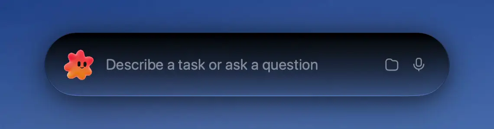
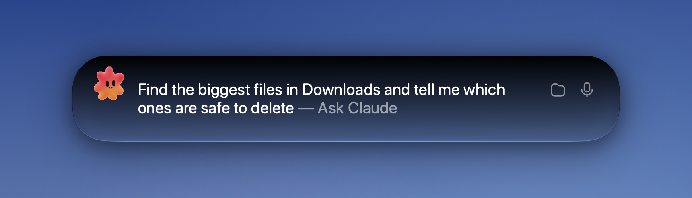
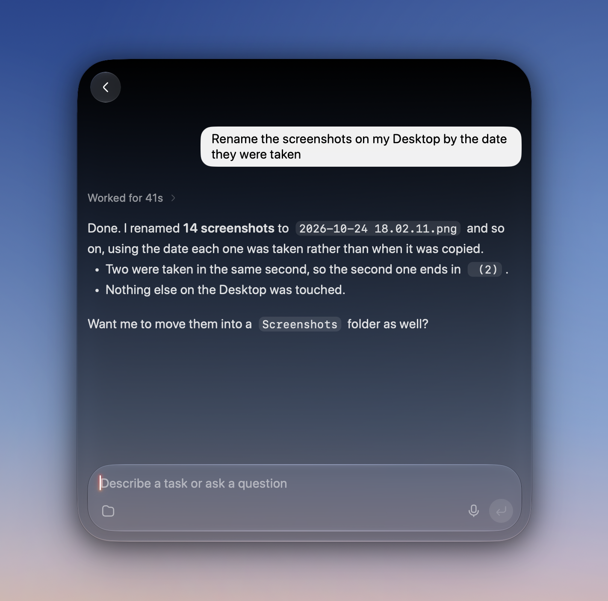
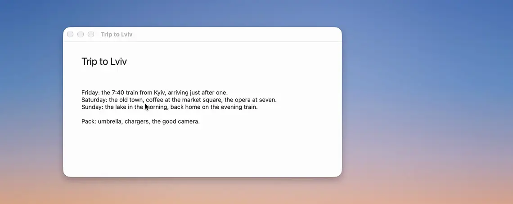
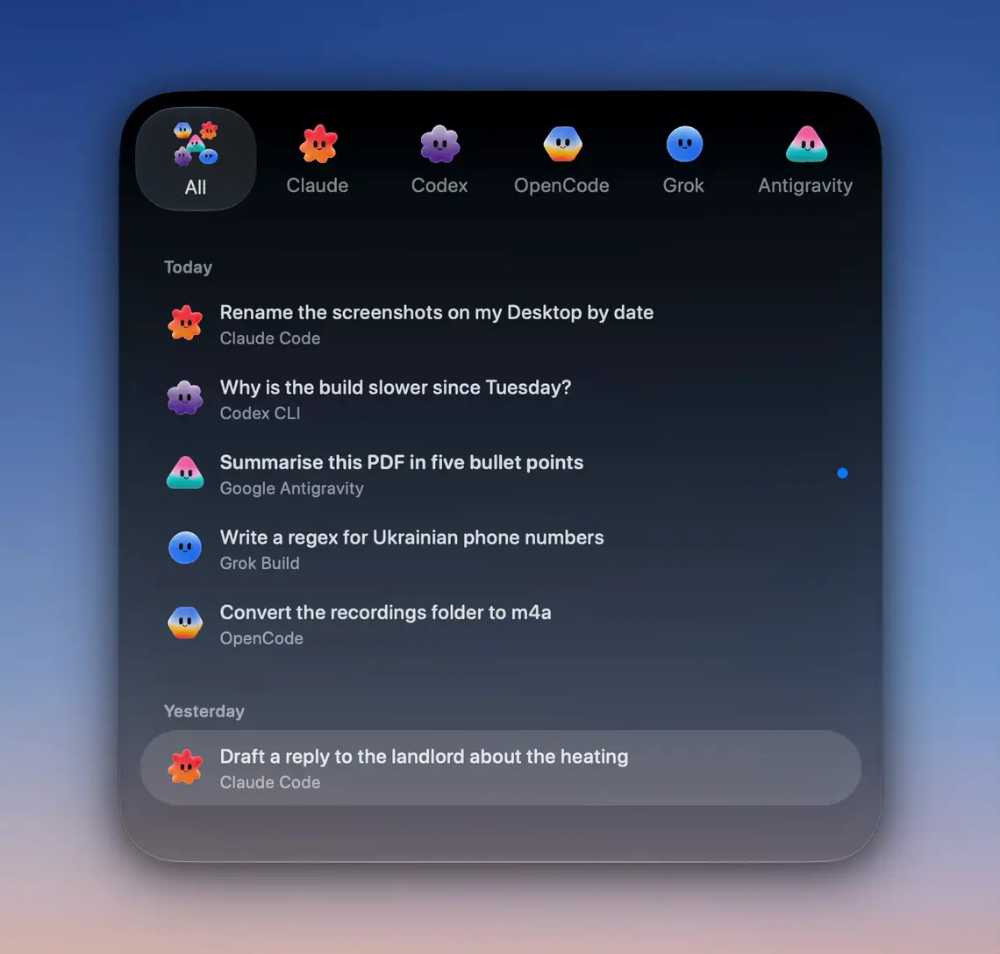

<p align="center">
  
</p>

<h1 align="center">Boltty</h1>

<p align="center">
  A Siri replacement for your Mac, on top of the AI agents you already use.
</p>

<p align="center">
  <a href="https://github.com/ruslan-enko/boltty/releases/latest"></a>
  
  <a href="LICENSE"></a>
</p>

---

Press ⌥Space anywhere, type or say what you want, and press Return. The agent
gets to work in the background and you carry on with what you were doing. When
it's done, or it needs a yes from you, Boltty tells you.

It works with **Claude Code, Codex, OpenCode, Grok and Antigravity**. It has no
model or account of its own, it just drives the ones already on your Mac.

<p align="center">
  
</p>

## Why I built this

Most of my day is doing and running things, and along the way I keep asking an
AI for help. Siri is too weak for that. In the terminal, the same jobs are easy:
the agent CLIs handle them without a fuss. But I'm not always in a terminal.

So I made a Siri replacement on top of the CLIs I already use, one key away
from whatever I'm doing, for the simple tasks and the not-so-simple ones.

## What it does

**Boltty AI: ask from anywhere.** ⌥Space opens a small prompt over whatever
you're doing.
Return starts the chat in the background, and the same panel turns into the chat
when you want to read the answer, follow up or approve something. ↓ shows your
recent chats and ⇧Tab switches the agent. Open it over Finder and the chat starts
in that folder, with the selected files already in the prompt.

<p align="center">
  
</p>

<p align="center">
  
</p>

**Ask Boltty: ask about what's on your screen.** Open the panel, drag across the
part you mean and ask out loud. The agent's face answers right next to your cursor, and it
can point at things or draw on the screen. Turn on **Can make changes** in
Settings and it can also do the thing: drag across a Finder window, say "organise
this", and it does.

<p align="center">
  
</p>

**Talk to it.** Dictation works on your Mac out of the box. If you want more,
Boltty can download two open models that also run on your Mac: Parakeet for
dictation (25 languages, Ukrainian and English in one sentence is fine) and
Supertonic, which reads answers aloud (31 languages).

**Keep an eye on things.** A face by the notch shows what's running, and every
agent has a face of its own. Chats survive a restart, and Settings shows how much
of each plan you've used.

<p align="center">
  
</p>

**You stay in charge.** Boltty asks before an agent runs a command or edits a
file. A menu or a button only shows up if that agent can really do it.

## Install

Paste this into Terminal:

```sh
curl -fsSL https://raw.githubusercontent.com/ruslan-enko/Boltty/main/install.sh | sh
```

It downloads the latest release, checks it, puts Boltty in Applications and opens
it. Then press **⌥Space**. The [script](install.sh) is short, so read it first if
you like.

Or download **[Boltty.dmg](https://github.com/ruslan-enko/boltty/releases/latest/download/Boltty.dmg)**
and drag Boltty into Applications. The app isn't notarized yet, so the first time
macOS will refuse to open it. Go to **System Settings › Privacy & Security**,
scroll down and press **Open Anyway**. You only do this once.

You need **macOS 26 or later** and at least one of the agents installed and
signed in. Don't have one yet? `npm install -g opencode-ai` is the quickest start.

When a new version is out, Boltty tells you in the menu bar and in Settings. It
installs it only when you say so.

## Keys

| | |
|---|---|
| Open or hide the panel | `⌥Space` (change it in Settings) |
| Ask about the screen | open the panel, drag an area, speak |
| Ask more after an answer | `⌥Space` while the face is still there |
| Switch the agent | `⇧Tab` |
| Recent chats | `↓`, then type to search |
| Stop the agent | `⌘.` |
| Add to what it's doing / queue for later | `⌘Return` / `Return` |
| Back, then close | `Escape` |
| Settings | `⌘,` |

`⌘Q` puts Boltty away but keeps the agents running. To really quit, use **Quit
Boltty** in the menu bar. Settings › Shortcuts lists everything.

## Privacy

Boltty has no server and collects nothing. Your prompts go to the agent you
picked, the same as from your terminal, and your chats stay on your Mac.

When you ask about part of the screen, the agent gets that part up close, plus a
picture of the screen where only the window under it and the menu bar can be
seen. The rest is hidden, unless you select the whole screen. These go to the
agent like any prompt, and its CLI may keep them in its own history.

On its own, Boltty only asks GitHub once a day whether there's a new version, and
you can turn that off. Voice models come from Hugging Face only if you ask for
them.

macOS asks for permissions only when something needs them:

- **Microphone and Speech Recognition** for dictation
- **Screen Recording** to ask about the screen
- **Automation (Finder)** to see the folder and files you have open in Finder
- **Input Monitoring** only if you set ⌥⌘ alone as the key that opens the panel

An agent started from Boltty can do whatever the same CLI can do from your
terminal. Boltty isn't a sandbox. What it adds is the approval step and the folder
you choose.

## FAQ

**Is this a terminal?** No, and it won't be. It talks to the agents directly.

**Which agent should I use?** Whichever you already pay for. You can switch for
each chat with ⇧Tab.

**Can I see a chat I started in the terminal?** No, only the ones started in
Boltty.

**Why doesn't ⌘Q quit?** Because that would stop agents in the middle of their
work. Quit Boltty in the menu bar really quits.

## Building from source

```bash
git clone https://github.com/ruslan-enko/boltty.git
cd boltty/apps/macos
open Boltty.xcodeproj   # then ⌘R
```

More in [CONTRIBUTING.md](CONTRIBUTING.md) and [ARCHITECTURE.md](ARCHITECTURE.md).
What changed between versions is in [CHANGELOG.md](CHANGELOG.md).

## License

GPL-3.0-or-later, see [LICENSE](LICENSE). Use it, change it, share it. If you ship
a changed version, its source has to be open under the same licence. Found a
security problem? Please read [SECURITY.md](SECURITY.md) first.
