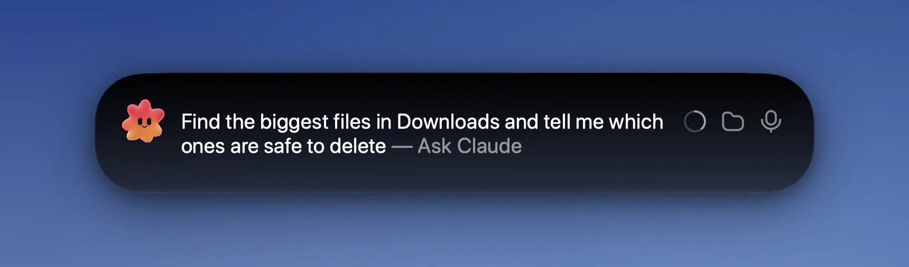
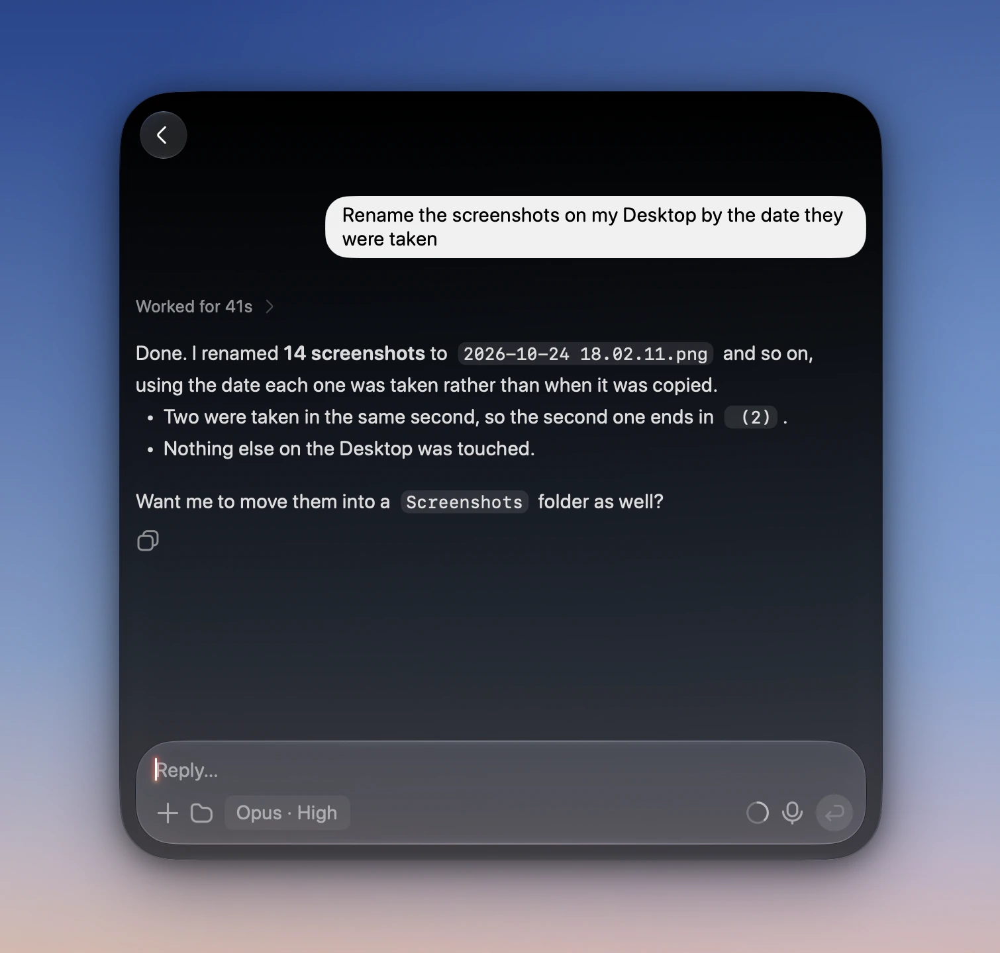
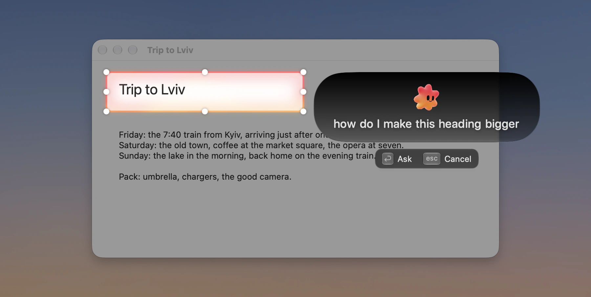
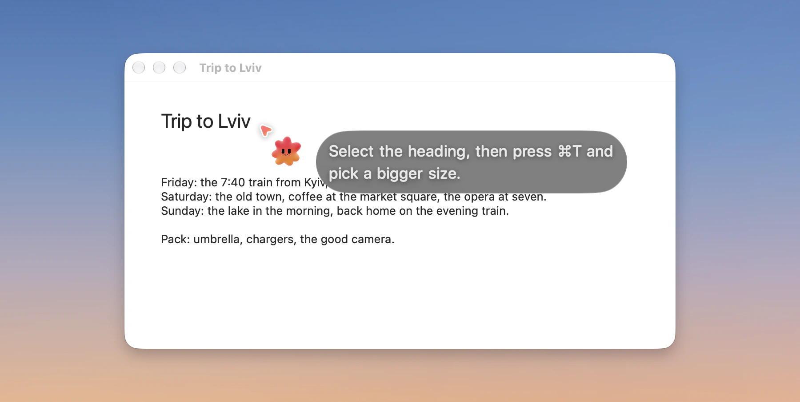
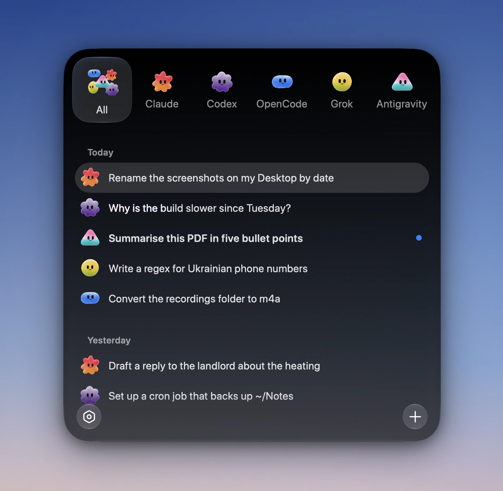
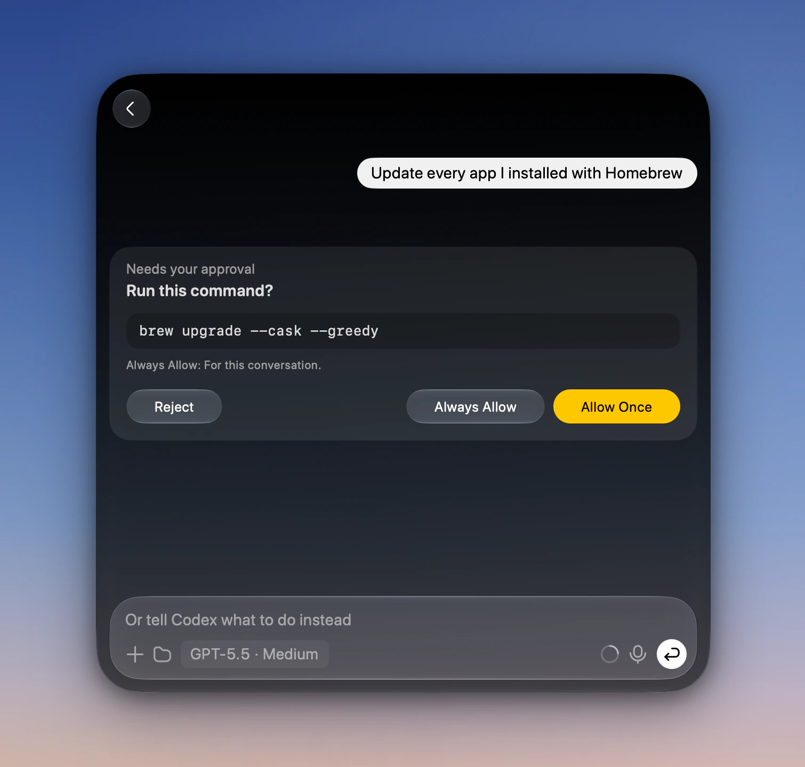

<p align="center">
  
</p>

<h1 align="center">Boltty</h1>

<p align="center">
  The AI agents you already use, one key away anywhere on your Mac.
</p>

<p align="center">
  <a href="https://github.com/ruslan-enko/boltty/releases/latest"></a>
  
  <a href="LICENSE"></a>
</p>

---

Press ⌥Space anywhere, type or say what you want, and press Return. The agent
gets to work in the background and you carry on with what you were doing. When
it's done, or it needs a yes from you, Boltty tells you.

It works with **Claude Code, Codex, OpenCode, Grok and Antigravity**. It has no
model or account of its own, it just drives the ones already on your Mac.

<p align="center">
  
</p>

## Why I built this

I kept opening a terminal for small things: find a file, fix a script, clean up a
folder. The agents there were good at it, but I had to stop what I was doing to ask.

Now I press ⌥Space, ask, and carry on.

## What it does

### Ask from anywhere

Press ⌥Space and a small prompt drops from the top of the screen. Ask for
something and press Return. You can close it right away, and the agent keeps
working. Open it again to read the answer or ask something else.

Press ↓ for your recent chats, or ⇧Tab to pick another agent. You can drop in files
and pictures too. If you're in Finder, Boltty starts in the folder you have open and
brings along the files you've selected.

<p align="center">
  
</p>

### Ask about your screen

See something you don't understand? Open the panel, drag across it and ask out
loud. The agent answers right next to your cursor, and can point at things or draw
on the screen to show you what it means. This is called Ask Boltty.

It only looks and explains at first. Turn on **Can make changes** in Settings and it
can do things too: drag across a Finder window, say "organise this", and it will.

<p align="center">
  
</p>

<p align="center">
  
</p>

### Talk instead of typing

Dictation works out of the box. You can also download two open models that run on
your Mac. Parakeet takes dictation in 25 languages, and you can mix Ukrainian and
English in one sentence. Supertonic reads answers aloud in 31.

### See what's going on

Every agent has its own face, and you choose how it looks. When one is working,
finishes or needs you, its face shows up by the notch. Your chats are still there after
a restart, and Boltty shows how much of each plan you've used.

<p align="center">
  
</p>

### You have the last word

Before an agent runs a command or edits a file, Boltty asks you. If you'd rather not
be asked every time, turn on Auto Mode for that agent or just for one chat.

<p align="center">
  
</p>

## Install

Paste this into Terminal:

```sh
curl -fsSL https://raw.githubusercontent.com/ruslan-enko/Boltty/main/install.sh | sh
```

It downloads the latest release, checks it, puts Boltty in Applications and opens
it. Then press **⌥Space**. The [script](install.sh) is short, so read it first if
you like.

Or download **[Boltty.dmg](https://github.com/ruslan-enko/boltty/releases/latest/download/Boltty.dmg)**
and drag Boltty into Applications. The app isn't notarized yet, so the first time
macOS will refuse to open it. Go to **System Settings › Privacy & Security**,
scroll down and press **Open Anyway**. You only do this once.

You need **macOS 26 or later** and at least one of the agents installed and
signed in. Don't have one yet? Boltty can install it for you, and you
sign in.

When a new version is out, Boltty tells you in the menu bar and in Settings. It
installs it only when you say so.

## Keys

| | |
|---|---|
| Open or hide the panel | `⌥Space` (change it in Settings) |
| Ask about the screen | open the panel, drag an area, speak |
| Ask more after an answer | `⌥Space` while the face is still there |
| Switch the agent | `⇧Tab` |
| Recent chats | `↓`, then type to search |
| Stop the agent | `⌘.` |
| Add to what it's doing / queue for later | `⌘Return` / `Return` |
| Back, then close | `Escape` |
| Settings | `⌘,` |

`⌘Q` puts Boltty away but keeps the agents running. To really quit, use **Quit
Boltty** in the menu bar. Settings › Shortcuts lists everything.

## Privacy

Boltty has no server and collects nothing. Your prompts go to the agent you
picked, the same as from your terminal, and your chats stay on your Mac.

When you ask about part of the screen, the agent gets that part up close, plus a
picture of the screen where only the windows in it and the menu bar can be
seen. The rest is hidden, unless you select the whole screen. These go to the
agent like any prompt, and its CLI may keep them in its own history.

On its own, Boltty only asks GitHub once a day whether there's a new version, and
you can turn that off. Voice models come from Hugging Face only if you ask for
them.

macOS asks for permissions only when something needs them:

- **Microphone and Speech Recognition** for dictation
- **Screen Recording** to ask about the screen
- **Automation (Finder)** to see the folder and files you have open in Finder
- **Input Monitoring** only if you set ⌥⌘ alone as the key that opens the panel

An agent started from Boltty can do whatever the same CLI can do from your
terminal. Boltty isn't a sandbox. What it adds is the approval step and the folder
you choose.

## Building from source

```bash
git clone https://github.com/ruslan-enko/boltty.git
cd boltty/apps/macos
open Boltty.xcodeproj   # then ⌘R
```

More in [CONTRIBUTING.md](CONTRIBUTING.md) and [ARCHITECTURE.md](ARCHITECTURE.md).
What changed between versions is in [CHANGELOG.md](CHANGELOG.md).

## Support

Boltty is free and open source, and I build it on my own. If it's useful to
you, you can [buy me a coffee on Ko-fi](https://ko-fi.com/enkowork). It helps me
keep working on it.

<p>
  <a href="https://ko-fi.com/enkowork"></a>
</p>

## License

MIT, see [LICENSE](LICENSE). Use it, change it, share it, keeping the
copyright notice. Found a security problem? Please read
[SECURITY.md](SECURITY.md) first.
